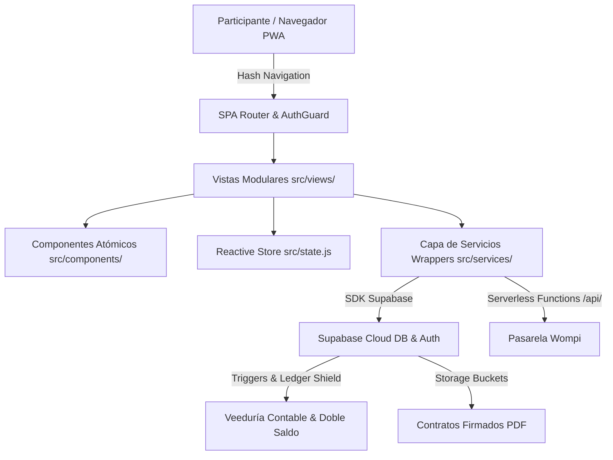
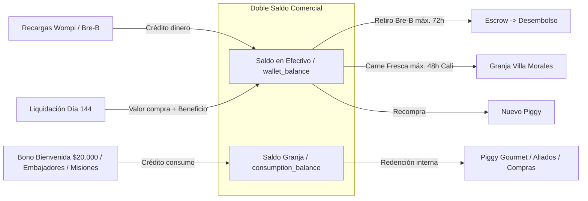

# 🐷 PIGGY APP — BLUEPRINT MAESTRO DE ARQUITECTURA Y ESPECIFICACIONES
## VERSIÓN CANÓNICA ALINEADA: `v2.6.0-ALIGNED-V5`
**Última Actualización:** Noviembre 2026  
**Entorno de Producción:** Vercel (`piggy-app-v2`)  
**Repositorio GitHub:** `amsterdamlab/piggy-app-v2`  
**Base de Datos & Auth:** Supabase PostgreSQL Cloud (`elhsvitbqzivgajccify.supabase.co`)  
**Tipo de Aplicación:** SPA (Single Page Application) / PWA (Progressive Web App) Mobile-First  
**Entidades:** Granja Villa Morales del Valle S.A.S. (Operador Productivo y Comercializadora) & Valle Piggy S.A.S. (Operadora Tecnológica)

---

## 📑 ÍNDICE GENERAL

1. [Ficha Técnica y Resumen](#1-ficha-técnica-y-resumen)
2. [Propuesta de Valor y Modelo de Agro-Comercio Digital](#2-propuesta-de-valor-y-modelo-de-agro-comercio-digital)
3. [Arquitectura General del Sistema (Stack & Capas)](#3-arquitectura-general-del-sistema-stack--capas)
4. [Sistema de Diseño Atómico & Paleta Oficial V5](#4-sistema-de-diseño-atómico--paleta-oficial-v5)
5. [Catálogo Integral de Vistas (Rutas) & Modales](#5-catálogo-integral-de-vistas-rutas--modales)
6. [Motor Comercial, Ciclos de Engorde y Categorías](#6-motor-comercial-ciclos-de-engorde-y-categorías)
7. [Ecosistema de Gamificación, Misiones y Embajadores](#7-ecosistema-de-gamificación-misiones-y-embajadores)
8. [Sistema de Doble Saldo Comercial & Veeduría Contable](#8-sistema-de-doble-saldo-comercial--veeduría-contable)
9. [Modelo de Base de Datos Supabase (Tablas, Triggers y RLS)](#9-modelo-de-base-de-datos-supabase-tablas-triggers-y-rls)
10. [Pasarela de Pagos & Webhooks (Wompi & Bre-B)](#10-pasarela-de-pagos--webhooks-wompi--bre-b)
11. [Módulos Satélite Especiales (Gourmet, Contrato PDF, Noticias, PWA)](#11-módulos-satélite-especiales-gourmet-contrato-pdf-noticias-pwa)
12. [Protocolo de Recuperación Rápida & Plan de Contingencia](#12-protocolo-de-recuperación-rápida--plan-de-contingencia)

---

## 1. FICHA TÉCNICA Y RESUMEN

| Parámetro | Especificación |
| :--- | :--- |
| **Versión Documental** | `v2.6.0-ALIGNED-V5` (alineada a `MANUAL_DE_MARCA_V5.md` y `PRODUCT.md`) |
| **Frontend Framework** | Vanilla JavaScript Modular (ES Modules nativos) |
| **Bundler & Dev Server** | Vite 6.x |
| **Backend as a Service** | Supabase (PostgreSQL 15+, GoTrue Auth, Realtime, Storage) |
| **Generación de Contratos** | `pdf-lib` (Contrato Marco Tripartito de 28 cláusulas, firma en canvas y código único `PGY-TX-...`) |
| **Procesamiento de Pagos** | Wompi API Widget + Webhooks serverless + Llaves Bre-B |
| **Patrón de Estado** | Reactive Pub/Sub Store unificado (`src/state.js`) |
| **Enrutamiento** | Hash SPA Router (`#/ruta`) con AuthGuard y Scroll Reset dinámico |
| **Compatibilidad PWA** | Web App Manifest + Service Worker + Landing dedicada `#/descargar` |

---

## 2. PROPUESTA DE VALOR Y MODELO DE AGRO-COMERCIO DIGITAL

**Piggy App** (*"Tu granja de engorde en tu celular."*) es una plataforma de **agro-comercio digital** diseñada para acercar a cualquier persona en Colombia (B2C) y a conocedores cárnicos (B2B: carnicerías, asaderos y restaurantes) al ciclo real de engorde porcino tecnificado de **Granja Villa Morales del Valle S.A.S.** **No es una entidad financiera ni un mecanismo de captación.**

### Pilares del Modelo:
1. **Compra Productiva de Cerdos de Engorde:** Cada participante adquiere su cerdito desde **`$1.000.000`** respaldado en un animal real, trazable y con contrato comercial legal firmado a su nombre.
2. **Ciclo Productivo Oficial:** Exactamente **20 semanas / 144 días (4 meses con 3 semanas)**, desde destete (**`~6 kg`**) hasta cosecha en pie (**hasta `110 kg`** según categoría).
3. **Beneficio Comercial Proyectado Escalonado (8% al 13%):**
   - **1 Piggy activo:** `8%` beneficio comercial base proyectado (`$1.080.000` sobre `$1.000.000`).
   - **2 Piggies activos:** `9%` beneficio comercial base proyectado por unidad (`$1.090.000`).
   - **3 o más Piggies activos:** `10%` beneficio comercial base proyectado por unidad (`$1.100.000`).
   - **Categorías del Marketplace** suman **`+1%` (Plus)**, **`+2%` (Dorado)** o **`+3%` (Premium)** exclusivamente al cerdito específico (tope proyectado total: `13%`).
4. **Cierre de Ciclo al Día 144 (Libertad Total de Liquidación):**
   - **Opción A (Dinero en Efectivo):** Transferencia del valor liquidado a llave **Bre-B** en máximo **72 horas** hábiles.
   - **Opción B (Carne Fresca Magra):** Entrega directa desde Granja Villa Morales en máximo **48 horas** (exclusivo **Cali y alrededores**) o redención en la tienda **Piggy Gourmet** y red de **Aliados**.
   - **Opción C (Mixto o Recompra):** Parte dinero + parte carne, o recompra de un nuevo Piggy retirando el excedente.

---

## 3. ARQUITECTURA GENERAL DEL SISTEMA (STACK & CAPAS)

La aplicación sigue estrictamente **Separación de Responsabilidades (SoC)** y **Desacoplamiento Total**:

### Capas del Sistema:
1. **Capa de Presentación (UI/UX):** Vistas autocontenidas con función de limpieza (`cleanup`) y submódulos desacoplados en `src/views/granja/`.
2. **Capa de Estado (`src/state.js`):** Store reactivo Pub/Sub para sesión, perfil, cerditos activos, catálogo de mercado, misiones y banderas de interfaz.
3. **Capa de Servicios & Wrappers (`src/services/`):** Aislamiento de SDKs y llamadas de red, con respaldo de datos de prueba en `src/services/mockData.js`.
4. **Capa de Datos y Reglas de Servidor (PostgreSQL):** Funciones RPC (`buy_piggy`, `sync_piggy_weights`, `mark_expired_piggies`, `process_referral_on_purchase`) y triggers contables blindados.

---

## 4. SISTEMA DE DISEÑO ATÓMICO & PALETA OFICIAL V5

Referencia obligatoria: `MANUAL_DE_MARCA_V5.md` (solo colores derivados del logotipo oficial):

### Paleta Oficial V5:
| Token | Nombre | HEX | Uso Principal |
| :--- | :--- | :---: | :--- |
| `--piggy-plum` | Deep Plum | `#8A0B52` | Logo, titulares sobre claro, sellos |
| `--piggy-magenta` | Piggy Magenta | `#E91E63` | Botón primario (píldora), progreso, precios |
| `--piggy-neon` | Neón | `#FF4B8B` | Wordmark y acentos sobre fondo oscuro |
| `--piggy-skin` | Rosa porcino | `#FF85B3` | Chips, etiquetas, detalles |
| `--piggy-light` | Luz de borde | `#FFF0F5` | Fondo claro de Piggy App |
| `--piggy-white` | Blanco | `#FFFFFF` | Tarjetas, contratos, texto sobre oscuro |
| `--piggy-night-2` | Plum Profundo | `#5E0738` | Tarjetas sobre oscuro (Landing/Admin) |
| `--piggy-night` | Ciruela Noche | `#2B0519` | Fondo oscuro y texto principal |
| `--piggy-ink-2` | Tinta secundaria | `#6E4A5E` | Texto secundario sobre claro |

* **Tipografía:** `Outfit` (Bold 700 / ExtraBold 800 para titulares, botones y cifras) + `Inter` (400 / 500 / 600 para texto, tablas con `tabular-nums` y contratos).
* **Iconografía:** Exclusivamente SVG de trazo `2px` (`stroke="currentColor"`, `fill="none"`). Sin emojis en botones, menús ni tablas de UI.
* **Moneda:** Formato `$1.000.000`, `$20.000` (signo pegado, punto de miles, **prohibido escribir `COP`**).
* **Layout Móvil:** `--app-max-width: 480px`, `--bottom-nav-height: 72px`, `--header-height: 56px`.

---

## 5. CATÁLOGO INTEGRAL DE VISTAS (RUTAS) & MODALES

### Mapa de Rutas Registradas en `src/router.js`:

| Ruta Hash | Vista | Archivo Fuente | Requiere Auth | Descripción |
| :--- | :--- | :--- | :---: | :--- |
| `#/auth` | Autenticación | `src/views/AuthView.js` | No | Login, Registro, Google OAuth, Recuperación de clave. |
| `#/granja` | Dashboard Granja | `src/views/GranjaView.js` | **Sí** | Centro de control de cerditos, pesos, consejos y doble saldo. |
| `#/mercado` | Mercado | `src/views/MercadoView.js` | **Sí** | Compra de Piggies Estándar, Plus, Dorado, Premium y Avanzados. |
| `#/aliados` | Red de Aliados | `src/views/AliadosView.js` | **Sí** | Directorio de restaurantes, carnicerías y aliados con beneficios. |
| `#/gourmet` | Piggy Gourmet | `src/views/PiggyGourmetView.js` | **Sí** | Tienda de cortes magros y combos parrilleros. |
| `#/adopcion` | Wizard Compra | `src/views/AdopcionView.js` | **Sí** | Calculadora de compra productiva y selección de cantidad. |
| `#/contrato` | Contrato Legal | `src/views/ContratoView.js` | **Sí** | Contrato Marco Tripartito con firma digital y descarga PDF. |
| `#/piggy/:id` | Ficha de Piggy | `src/views/PiggyDetailView.js` | **Sí** | Evolución de peso (`~6 kg` → hasta `110 kg`) y etapa zootécnica. |
| `#/referidos` | Embajadores | `src/views/ReferidosView.js` | **Sí** | Código único, enlace de invitación y tabla de comisiones. |
| `#/perfil` | Perfil & Movimientos | `src/views/ProfileView.js` | **Sí** | Datos personales, KYC, historial de movimientos y llave Bre-B. |
| `#/descargar` | Instalador PWA | `src/views/DescargarView.js` | No | Landing pública para instalación PWA en iOS y Android. |

### Ecosistema Modular de Sub-Modales (`src/views/granja/`):
1. **`WalletBlock.js`:** Banner de saldos en Granja con acceso rápido a recargar y retirar.
2. **`WalletDrawerModal.js`:** Cajón principal de Cuenta Agro con desglose de Saldo en Efectivo, Saldo Granja y movimientos.
3. **`WalletRechargeModal.js`:** Flujo de recargas mediante **Wompi** (tarjetas, PSE, Nequi) y **Bre-B** (con comprobante).
4. **`WalletWithdrawalModal.js`:** Solicitud de retiro hacia llave **Bre-B** con validación de Saldo en Efectivo y escrow preventivo.
5. **`MissionsBlock.js`:** Módulo dinámico de misiones activas.
6. **`CycleMissionModal.js`:** Misión de cierre de ciclo / recompra (M10).
7. **`FlashMissionModal.js`:** Misiones relámpago programadas con temporizador (M8/M9).
8. **`CompletedPiggiesModal.js`:** Celebración y selección de liquidación al finalizar las 20 semanas (144 días).
9. **`WelcomeBonusModal.js`:** Acreditación del bono de bienvenida de `$20.000` en Saldo Granja.
10. **`OnboardingTourModal.js`:** Recorrido guiado para nuevos participantes.
11. **`ReferralsModal.js`:** Panel de Embajadores (niveles Bronce, Plata, Oro y enlace WhatsApp).
12. **`SupportModal.js`:** Conexión directa con soporte oficial vía WhatsApp.

---

## 6. MOTOR COMERCIAL, CICLOS DE ENGORDE Y CATEGORÍAS

### 1. Fórmula de Beneficio Comercial Proyectado
$$\text{Total Proyectado} = \text{Valor de Compra} + \bigl(\text{Valor de Compra} \times (\text{Base} + \text{Extra Categoría})\bigr)$$

* **Base por cantidad de Piggies activos:**
  * `1 Piggy` → **`8%`** (`$1.080.000` sobre `$1.000.000`)
  * `2 Piggies` → **`9%`** (`$1.090.000` c/u)
  * `3+ Piggies` → **`10%`** (`$1.100.000` c/u)
* **Bonificación de categoría:** Aplica exclusivamente al cerdito específico (`+1%`, `+2%` o `+3%`), proyectando un beneficio comercial total entre **`8%` y `13%`**.

### 2. Categorías Oficiales de Cerditos (Tope Estricto `110 kg`)
| Categoría | Código en DB | Adicional | Peso Final Objetivo | Canal / Característica |
| :--- | :--- | :---: | :---: | :--- |
| **Estándar** | `estandar` | `+0%` | `80–90 kg` | Ciclo completo de 144 días desde `~6 kg`. |
| **Plus** | `plus` *(legacy `silver`)* | **`+1%`** | **`80–90 kg`** | Tiendas, mini-markets y supermercados. |
| **Dorado** | `dorado` *(legacy `gold`)* | **`+2%`** | **`90–100 kg`** | Empresas, colegios y hospitales. |
| **Premium** | `premium` | **`+3%`** | **`100–110 kg`** | Cadenas de restaurantes y hospedajes premium (tope `110 kg`). |
| **Avanzado** | `avanzado30` / `45` / `60` / `75` / `90` | `+0%` | **`80–90 kg`** | Lotes con **15 a 90 días de avance previo** (cierre más corto). |

### 3. Curva Biológica y Etapas del Ciclo (144 Días / 20 Semanas)
* **Peso inicial (post-destete):** `6,0 kg` → **Peso final:** según categoría (máximo absoluto `110,0 kg`).
* **3 Etapas visuales de fotografía:**
  * **Stage 1 (Días 0–30):** `et1-{1..5}.jpg`
  * **Stage 2 (Días 31–90):** `et2-{1..5}.jpg`
  * **Stage 3 (Día 91 a 144 / Cosecha):** `et3-{1..5}.jpg`
* **10 Sub-etapas zootécnicas en la App (`getPiggyGrowthStage`):**
  1. Destete (`0%–<5%`) · 2. Climatización Controlada (`5%–<9%`) · 3. Adaptación de Corral (`9%–<14%`) · 4. Nutrición Adaptativa (`14%–<21%`) · 5. Nutrición Fortificada (`21%–<27%`) · 6. Alimento Proteico (`27%–<35%`) · 7. Desarrollo Acelerado (`35%–<62%`) · 8. Engorde Final (`62%–<98%`) · 9. Preparación de Salida (`98%–<100%`) · 10. Salida al Mercado (`100%`).

---

## 7. ECOSISTEMA DE GAMIFICACIÓN, MISIONES Y EMBAJADORES

### Misiones
1. **Misiones Permanentes (M1 a M9):** Registro con bono de `$20.000`, compra del primer Piggy, visita/compartido de Embajadores, compra de 2do y 3er Piggy, compra en Aliados, cierre de primer ciclo, ofertas semanales y primera compra de un referido.
2. **Misiones de Ciclo (M10):** Notificación automática al día 144 para recompra preferencial en cerditos especiales.
3. **Misiones Relámpago (Flash Missions):** Campañas por tiempo limitado gestionadas desde `PIGGY ADMIN` con cuenta regresiva.

### Plan de Embajadores (Liquidado en Primera Compra del Referido)
* **Bono de bienvenida al referido:** `$20.000` en Saldo Granja.
* **Bronce (`0–5` referidos completados):** **`$20.000`** por compra efectiva.
* **Plata (`6–15` referidos completados):** **`$30.000`** por compra efectiva.
* **Oro (`16+` referidos completados):** **`$50.000`** por compra efectiva.

---

## 8. SISTEMA DE DOBLE SALDO COMERCIAL & VEEDURÍA CONTABLE

### Reglas de Veeduría Estricta:
1. **Separación de Saldos:** `consumption_balance` (Saldo Granja) nunca se retira a efectivo; se redime en cortes de carne, Aliados o compras autorizadas.
2. **Escrow en Retiros:** Al registrar una solicitud en `wallet_withdrawal_requests`, el monto se reserva mediante trigger para prevenir doble gasto.
3. **Inmutabilidad Contable:** Todo cambio en `profiles.wallet_balance` o `profiles.consumption_balance` requiere asiento 1:1 en `wallet_transactions` (reconciliado automáticamente por triggers).

---

## 9. MODELO DE BASE DE DATOS SUPABASE (TABLAS, TRIGGERS Y RLS)

### Tablas Principales en `public.*`:
1. **`profiles`:** `id`, `full_name`, `whatsapp` (UNIQUE), `email`, `cedula`, `terms_accepted`, `habeas_data_accepted`, `wallet_balance` (Saldo en Efectivo), `consumption_balance` (Saldo Granja), `referral_code` (UNIQUE), `referred_by`, `bank_name`, `bank_account_type`, `bank_breve_key`.
2. **`piggies`:** `id`, `user_id`, `name`, `status` (`engorde`, `completado`, `liquidado`), `category`, `purchase_date`, `end_date` (`+144` días), `fixed_end_date`, `investment_amount`, `extra_roi_bonus`, `current_weight` (`6,0` → `final_weight`), `final_weight` (máx. `110,0`), `contract_url`, `contract_code`, `image_url`.
3. **`marketplace`:** `id`, `item_name`, `description`, `price`, `extra_roi`, `stock`, `category` (`piggy_category_enum`), `days_advanced`, `days_remaining`, `current_month`, `current_weight`, `fixed_end_date`, `image_url`.
4. **`wallet_transactions`:** `id`, `user_id`, `amount`, `type`, `wallet_type` (`dinero`, `consumo`), `description`, `payment_method`, `simulation_status`.
5. **`wallet_withdrawal_requests`:** `id`, `user_id`, `amount`, `net_amount`, `retention_amount`, `bank_info`, `status`.
6. **`wallet_recharge_requests`:** `id`, `user_id`, `amount`, `payment_method` (`wompi`, `bre_b`), `receipt_url`, `status`.
7. **`referrals`:** `id`, `referrer_id`, `referred_id`, `status`, `commission_amount`, `commission_tier`, `completed_at`.
8. **`allies`**, **`missions` / `user_flash_missions`**, **`news_billboard`**, **`piggy_gourmet_orders`**.

### Seguridad (RLS) y RPCs:
* RLS activo en todas las tablas (`auth.uid() = user_id` o `auth.uid() = id`).
* RPCs principales: `buy_piggy`, `sync_piggy_weights`, `mark_expired_piggies`, `process_referral_on_purchase`, `validate_referral_code`, `link_referral`, `decrement_marketplace_stock`.

---

## 10. PASARELA DE PAGOS & WEBHOOKS (WOMPI & BRE-B)

1. **Wompi Widget & Firma Serverless (`/api/wompi-signature`):** Genera firma HMAC-SHA256 con `reference + amountInCents + "COP" + WOMPI_INTEGRITY_SECRET` *(nota: `"COP"` es el código ISO exigido únicamente por la API técnica de Wompi, nunca visible al usuario)*.
2. **Webhook Processor (`/api/wompi-webhook`):** Valida `WOMPI_EVENTS_SECRET`, acredita recargas aprobadas en `wallet_transactions` y dispara la creación de activos cuando corresponde.
3. **Transferencias Bre-B:** Comprobante almacenado en Supabase Storage (`receipts`) y notificación a soporte operativo.

---

## 11. MÓDULOS SATÉLITE ESPECIALES

1. **Generador de Contratos Marco Tripartitos (`src/services/contractService.js` + `src/data/contractClauses.js`):** 28 cláusulas oficiales entre **Granja Villa Morales del Valle S.A.S.**, **Valle Piggy S.A.S.** y el participante; firma táctil en `SignatureModal.js`, sello ISO 8601, código único `PGY-TX-...` y resguardo en Supabase Storage (`contracts/`). Incluye reserva operativa del **25%** de animales, reserva de contingencia del **5%**, retracto de **5 días hábiles** y retención del **30%** por desistimiento extemporáneo.
2. **Cartelera de Noticias (`NewsBillboardModal.js`):** Slider gestionado desde `PIGGY ADMIN`.
3. **PWA & `#/descargar`:** Service Worker y guía de instalación móvil iOS/Android.

---

## 12. PROTOCOLO DE RECUPERACIÓN RÁPIDA & PLAN DE CONTINGENCIA

1. **Despliegue de código:** Exclusivamente vía **GitHub MCP** hacia `amsterdamlab/piggy-app-v2` (rama `main`), previa compilación local con `npm run build`.
2. **Variables de entorno en Vercel:** `VITE_SUPABASE_URL`, `VITE_SUPABASE_ANON_KEY`, `WOMPI_PUBLIC_KEY`, `WOMPI_PRV_KEY`, `WOMPI_INTEGRITY_SECRET`, `WOMPI_EVENTS_SECRET`.
3. **Scripts SQL críticos en Supabase (orden de referencia):**
   - `supabase/migrations/20260216000000_initial_schema.sql`
   - `supabase/accounting_ledger_shield_and_reconciliation.sql`
   - `sql/enforce_wallet_veeduria_strict.sql`
   - `sql/escrow_wallet_requests.sql`
   - `supabase/setup_categories_and_advanced_piggies.sql`
   - `supabase/fix_piggies_weight_sync.sql` *(pesos `6 kg` → `80–90` / `90–100` / `100–110 kg`, tope `110 kg`)*
   - `supabase/fix_referral_reward_system.sql` *(Embajadores: Bronce `0–5` `$20.000`, Plata `6–15` `$30.000`, Oro `16+` `$50.000`)*

---
*Documento actualizado y alineado el 18 de Noviembre de 2026 con `MANUAL_DE_MARCA_V5.md`, `PRODUCT.md` y el código de producción de Piggy App.*
